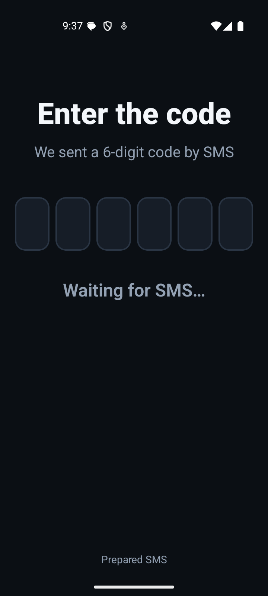
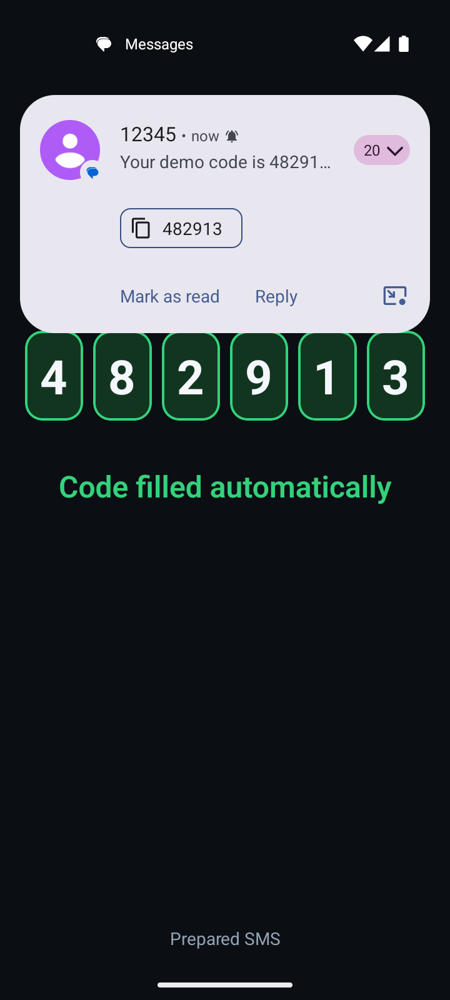
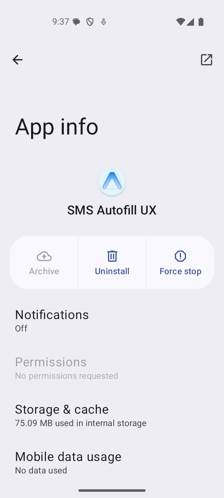

# sms-autofill-ux

An Android React Native demo: a login screen whose 6-digit code **fills in by
itself** when an SMS arrives, while the app holds **no SMS permission**.

It uses Google's **SMS Retriever API**. Play services reads the SMS, matches it
against the app's 11-character hash, and hands the app only that one message.
The app never asks to read your messages.

> Android only. Nothing here says anything about iOS.

|                               Waiting (control)                               |                        SMS arrives, code filled                         |                                        App info                                        |
| :---------------------------------------------------------------------------: | :---------------------------------------------------------------------: | :------------------------------------------------------------------------------------: |
|  |  |  |

## How it works

```
 SMS ──► telephony ──► Google Play services ──► SmsRetriever broadcast
                       (matches the app hash)         │
                                                      ▼
   VerifyScreen ◄── useSmsAutofill ◄── SmsRetrieverModule (Kotlin)
```

The SMS must **end with the app hash** and be at most **140 bytes**:

```
Your demo code is 482913 pcwxu2zGm7J
```

The hash comes from the package name and the signing certificate, so it differs
per package and per keystore. This repo signs release with the generated debug
keystore, so its debug and release builds share one hash (`pcwxu2zGm7J` for
`com.andirayka.smsautofillux`). The in-app "Prepared SMS" toggle shows the hash
of the installed build. See [docs/decisions.md](docs/decisions.md) and
[docs/architecture.md](docs/architecture.md).

The native side is a ~100-line local Expo module (`modules/sms-retriever`) on
`com.google.android.gms:play-services-auth-api-phone:18.1.0`.

## Run it

```sh
npm install
export ANDROID_HOME=$HOME/Library/Android/sdk
npx expo prebuild --platform android
cd android && ./gradlew :app:assembleRelease -x lint && cd ..
adb install -r android/app/build/outputs/apk/release/app-release.apk
```

Open the app, tap **Prepared SMS**, and send that exact text to the device (an
emulator: `adb emu sms send 12345 "Your demo code is 482913 <hash>"`).
A **Google Play** system image is required; Play services does the matching.

## Verify it

```sh
npm run typecheck && npm run lint && npm run format:check
npm test                                  # 19 unit, hook and screen tests
npm run verify:manifest                   # APK declares no SMS permission
npm run verify:emulator -- emulator-5554  # Maestro on the emulator, real SMS
```

`verify:emulator` runs one Maestro flow against a running emulator. It
injects each SMS with `adb emu sms send`, so Android's telephony stack delivers
it like a carrier message. Cases:

1. Control: empty boxes, "Waiting for SMS…".
2. The app's hash equals an independent computation from the keystore
   (`scripts/app-hash.sh`).
3. Wrong hash: nothing fills.
4. Right hash, no code: nothing fills.
5. Right hash, 7-digit number: nothing fills (not taken as a 6-digit code).
6. A correct SMS afterwards fills all six digits, so the window survived the
   three messages that must not fill.

## Evidence

| Claim                                                         | Label                            | Evidence                                                                                                                                        |
| ------------------------------------------------------------- | -------------------------------- | ----------------------------------------------------------------------------------------------------------------------------------------------- |
| A correct SMS fills the code with no SMS permission           | **repository-proven** (emulator) | `docs/evidence/emulator-run.txt`; screenshots above                                                                                             |
| The built APK declares no SMS permission                      | **repository-proven**            | `npm run verify:manifest`; App info shows "No permissions requested"                                                                            |
| Wrong hash, no-code SMS and a 7-digit run do not fill         | **repository-proven** (emulator) | same run, steps 3 to 5                                                                                                                          |
| The native hash equals the independently computed hash        | **repository-proven**            | step 2                                                                                                                                          |
| The assertions can fail                                       | **repository-proven**            | Mutation check: removing the digit-boundary check in `extractCode` fails 1 unit test and the Maestro "not filled" assertion for the 7-digit SMS |
| It works on a physical phone                                  | **unverified hypothesis**        | Not tested here; to be shown separately on a Samsung Galaxy S24 FE                                                                              |
| Texting your own number from the same phone triggers autofill | **unverified hypothesis**        | Delivery to the inbox was seen on a phone; autofill not tested                                                                                  |

Environment of the recorded run: AVD `Dev_Light_API_36`, Android 16 (API 36),
Google Play image, arm64, 2 GB RAM; release build signed with the debug
keystore; Expo SDK 58.0.14, React Native 0.88.0, Maestro 2.10.0,
`play-services-auth-api-phone` 18.1.0.

### Known limits

- The emulator's Maestro connection sometimes drops with "device offline"
  before the first assertion. `verify:emulator` reconnects and retries only
  such runs; a failed assertion is never retried.
- SMS Retriever does not consume the SMS. It still lands in the inbox and
  shows a notification; the app just does not need permission to see it.
- Only SMS works. WhatsApp or other chat messages never trigger it.
- The listen window lasts 5 minutes; the app then shows a timeout state.

## License

MIT
